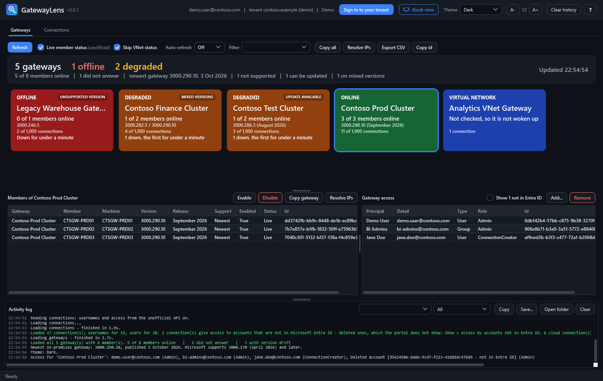
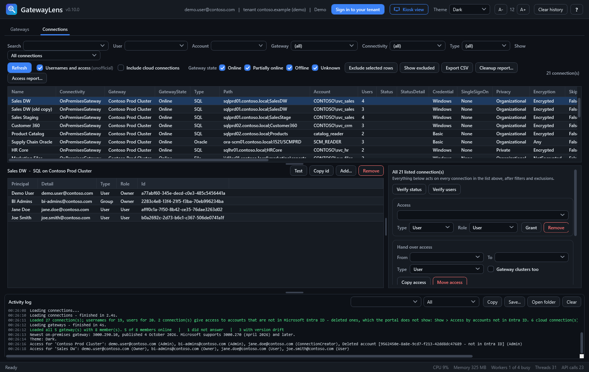
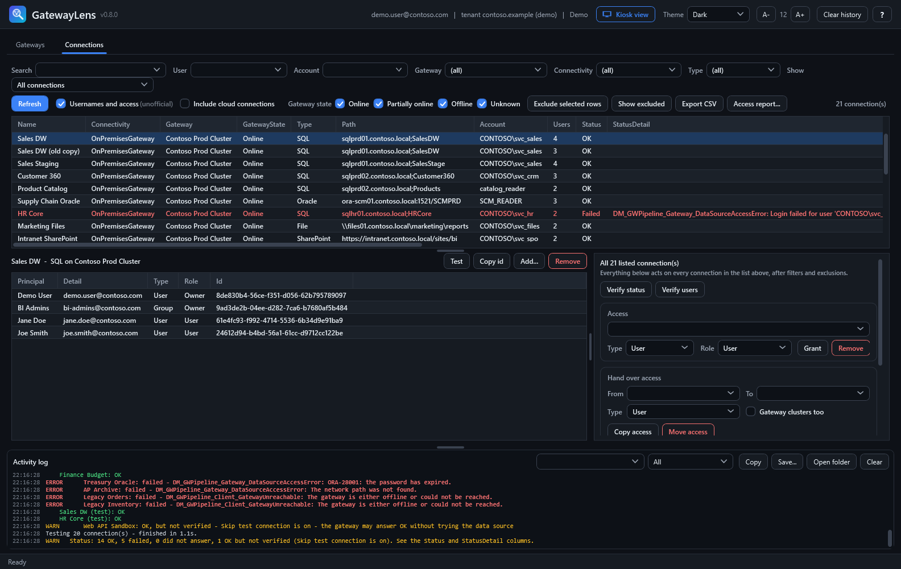
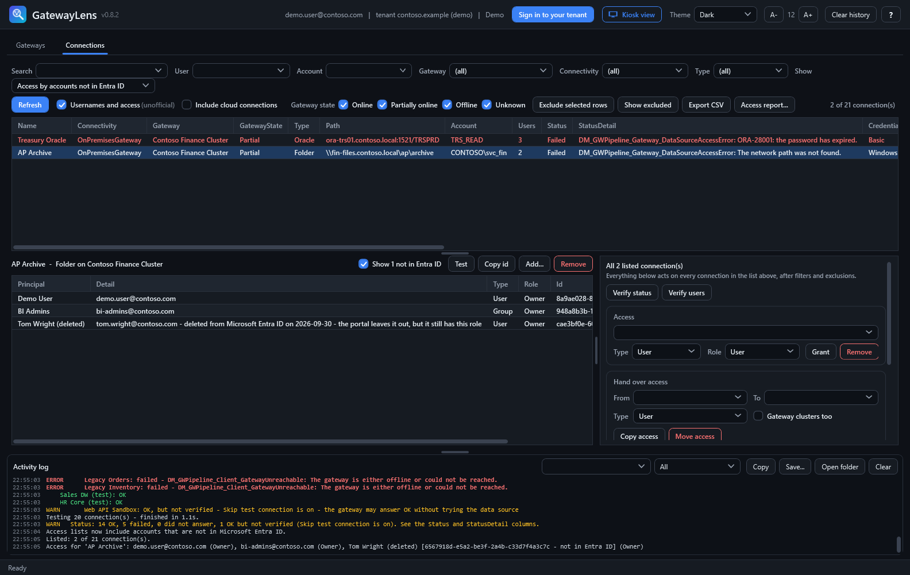
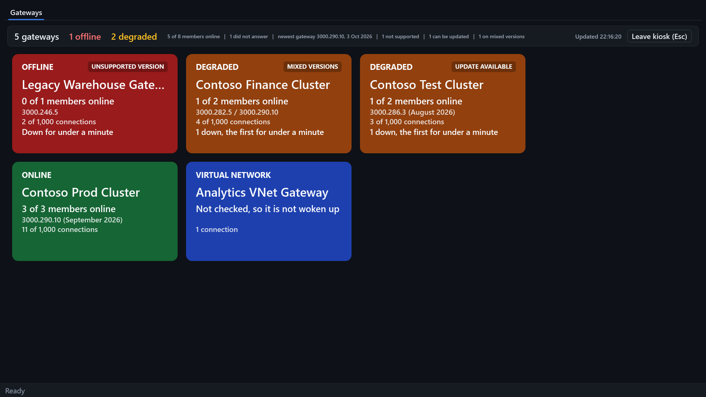
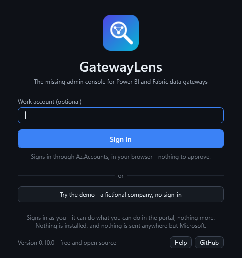
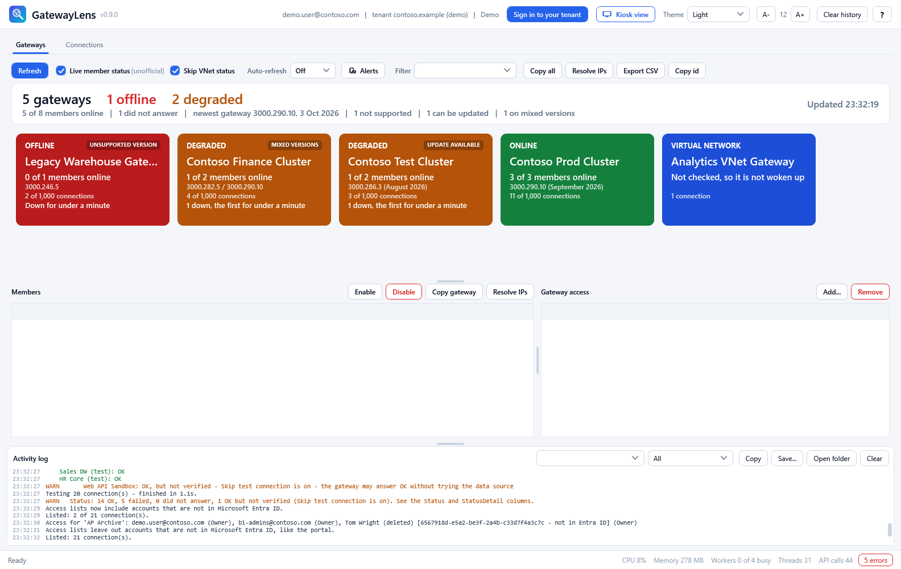

<p align="center"></p>

<h1 align="center">GatewayLens</h1>

<p align="center"><b>The missing admin console for Power BI and Fabric data gateways.</b><br>
Hundreds of gateway connections? Do in minutes what takes days in the portal.</p>

<p align="center">
  <a href="../../releases/latest"><b>Download GatewayLens.exe</b></a> &nbsp;|&nbsp;
  <a href="#try-it-in-two-minutes"><b>Try the demo in two minutes</b></a> &nbsp;|&nbsp;
  <a href="#what-it-does"><b>See everything it does</b></a>
</p>

<p align="center">
  
  
  
  
</p>



- **A service account password changed?** Update every connection that uses it in
  one run - and see straight away which ones work.
- **Someone leaving?** Move all their access - every connection, every gateway, the
  same roles - to their successor.
- **Access nobody can see?** Find the roles still held by accounts that were deleted
  from Microsoft Entra ID. The portal hides them; GatewayLens lists them.
- **A cluster filling up?** Find the connections nobody has used for months, and the
  duplicates, before you hit Microsoft's limit of 1,000.
- **What is down right now?** A live wall of every gateway cluster, on any screen.

Free and open source. One exe, nothing to install on the gateways, signs in as you.

## Built for big tenants

The portal's *Manage connections and gateways* page is fine for a handful of
connections. With dozens of gateway clusters and hundreds or thousands of
connections, everyday admin work turns into hours of clicking through one item at a
time. GatewayLens does the same work in bulk, safely:

| The job | In the portal | In GatewayLens |
|---|---|---|
| **Rotate a service account password** | Edit each connection's credentials, one by one | Filter by the account stored in the credentials, update every connection in one run - each one is then tested |
| **Someone leaves the company** | Find each connection and gateway they can use, share it again, remove them | **Move access**: their successor gets exactly the same roles everywhere, then theirs are removed |
| **Who can use what?** | Open each connection's list of users | Filter by person, by credential account, by server or database - and export an access report for the auditor |
| **Make room on a cluster** | Check connections one by one | Connections counted per cluster against the 1,000 limit; *not used for 90 days*, *no use recorded*, *duplicates*, *failing* - then delete, with a backup written first |
| **Is every gateway up, current and supported?** | Open each gateway | One coloured tile per cluster, a kiosk mode for a wall screen, versions checked against Microsoft's list of supported releases |
| **What changed, and who did it?** | - | Every change is recorded the moment it happens: who, when, what, and the result |
| **Who still has access after leaving?** | Not shown - the portal leaves deleted accounts out | *Access by accounts not in Entra ID* lists every connection they can still use |

## See it

**Find any connection** - by who has access, the account in its credentials, the
server or database - and see who can use it, by name.



**Test hundreds at once** - every result in the log as it comes, in colour, with the
gateway's own reason for each failure.



**Find what the portal hides** - roles still held by accounts deleted from Microsoft
Entra ID.



**A wall screen** - the kiosk view: full screen, nothing that changes anything,
refreshing every minute.



<details>
<summary>More: the start page, and the light theme</summary>





</details>

Every picture is the built-in demo - Contoso is fictional.

## What it does

### Monitor every gateway
- **One coloured tile per gateway cluster** - on-premises and virtual network: green
  online, amber degraded, red offline. Problems come first, so they are seen from
  across the room.
- Each tile shows members online ("1 of 2 members online"), the gateway version and
  its release month, how long a member has been down, and the cluster's connections
  against the 1,000 limit.
- **Versions against Microsoft's own list** - the newest build from the
  [Download Center](https://www.microsoft.com/en-us/download/details.aspx?id=53127)
  and the six monthly releases Microsoft still supports from
  [Learn](https://learn.microsoft.com/en-us/data-integration/gateway/service-gateway-monthly-updates).
  Badges say **UNSUPPORTED VERSION**, **UPDATE AVAILABLE**, **MIXED VERSIONS**,
  **NEAR CONNECTION LIMIT** or **AT CONNECTION LIMIT**.
- **Kiosk view** - full screen, tiles only, nothing that changes anything, refreshing
  every minute. The **Kiosk view** button, `-Kiosk` or F11; Esc leaves it.
- **VNet gateways are never woken up.** A status check starts a VNet gateway that has
  gone to sleep, and it then uses capacity - so *Skip VNet status* is on by default.
- Enable or disable one member or several at once, with a warning before the last
  one - only that cluster is read again. Copy a cluster as tab-separated text for
  Excel or a ticket. Resolve member machines to IP addresses.
- The tiles follow the text size, so a wall screen can fit all of them or show them large.

### Find any connection
Filters you can combine, which the portal does not have:
- **who has access** - one person, a group, anyone whose name or email contains a
  word. Fabric gives only object ids; GatewayLens shows the names, from Microsoft Graph
- **access by accounts that no longer exist** - deleted from Microsoft Entra ID, but
  still holding their roles
- **the account stored in the credentials** - every connection that uses `svc_sales`
- **the server, database or path** - several values at once: `sql01; sql02; ora-prd`
- gateway, connectivity, type, and whether the connection's gateway is online
- gateway connections only by default; cloud connections with one tick

Every list works like a spreadsheet: **click a column name to sort** - the sort stays
through refreshes - and **copy** a cell, the selected rows or all of them, with or
without the column names (Ctrl+C, Ctrl+Shift+C, or right-click). It pastes into Excel
as cells. **Double-click a cell** to select just part of it, such as a server name in
a long path.

### Change hundreds of connections at once
Everything acts on every listed connection - filter first, exclude what you want to
leave alone, then press one button:
- **Update credentials** - Windows, Basic, Anonymous or Key - and **test them
  afterwards**, so you know at once which ones still fail.
- **Grant** or **remove** access for any number of people and groups. Someone who
  already has the role is left alone, a lower role is raised, and the list is read
  again afterwards, so it shows what really happened.
- **Verify status** - the gateway's own reason for every failing connection, each one
  in the log as it is tested. A connection with *Skip test connection* on is marked
  **Unverified**: its test passes whatever the data source says.
- **Verify users** - who has access to each one, by name, in the list and the log.
- **Delete** - only after typing the count, and only after a backup is written.

### Hand over access
For someone leaving, or a new owner of a team's connections. Name who hands over and
who takes over. **Copy access** gives the successor exactly the same roles on every
listed connection - and, with *Gateway clusters too*, on every gateway cluster -
raising a lower role where they already have one. **Move access** does that, then removes the old roles - but
only where the successor has them by then, so nothing is ever left without an owner.

### Clean up before you hit the limit
Microsoft allows
[1,000 data sources per gateway cluster](https://learn.microsoft.com/en-us/data-integration/gateway/service-gateway-onprem).
Every tile counts the connections on its cluster, and the **Show** filter finds the
ones to remove:
- **Last used over 30, 90, 180 or 365 days ago**, and **no use recorded**, from
  Microsoft's connection recency *(preview in Fabric)*
- **Duplicates** - the same gateway, type, path and account, side by side
- **Failing tests** - after Verify status
- **Skip test connection on** - connections whose test always passes
- **Access by accounts not in Entra ID** - roles still held by deleted accounts,
  which the portal does not show

Connection recency is also in the connections export and the access report: when
each connection was created, last linked to an item, and last used at run time.

### Prove it to an auditor
- **Access report** - one row per connection or gateway and person, with the role,
  read fresh from Fabric. With the User filter set: everything that one person can
  access.
- **Change record** - every change GatewayLens makes, one row each, as it happens:
  who, when, what, the person and role, the result, and Microsoft's reason for
  anything that failed. If the record cannot be written, the change is not made.
- CSV export of any list, ready for Excel.

## Try it in two minutes

```powershell
.\GatewayLens.ps1 -Demo
```

Demo mode opens the real application on Contoso, a fictional company: gateways
online, offline and slow, connections that fail for different reasons, a stale
duplicate, people and groups. Every button works, nothing leaves your computer, and
no sign-in is needed. Things to try:

1. **Kiosk view** (F11) - the wall screen.
2. **Connections > Verify status** - five connections fail, and the *StatusDetail* column
   says why: a login, an expired password, a gateway that is offline.
3. **Joe Smith is leaving**: set *User* to `joe.smith`, press *Verify users*, then in
   *Hand over access* set *To* to `ana.novak@contoso.com` and press *Move access*.
4. **Show > Duplicates** - a stale copy of Sales DW is taking a slot on the Prod cluster.

## Use it on your tenant

**The exe** - download `GatewayLens.exe` from [Releases](../../releases) and run it.
It carries the script inside it and starts it in PowerShell 7; if PowerShell 7 is
missing, it says how to install it.

**Or the script:**

```powershell
Unblock-File .\GatewayLens.ps1      # allow the downloaded script to run
.\GatewayLens.ps1 -SelfTest         # what works for your account - read-only, changes nothing
.\GatewayLens.ps1                   # the console
```

It opens on a start page: sign in when you are ready - with an admin account, if
you keep one - or try the demo first.

Run the self-test first - `GatewayLens.exe -SelfTest` works too. It signs you in,
calls every API once and reports what your account can and cannot do, so a missing
permission shows up as one clear line instead of an empty grid.

### Requirements and sign-in

- Windows with **PowerShell 7.2 or later** - `winget install Microsoft.PowerShell`
- Nothing else. GatewayLens signs in **as you**, in the browser, and acts with your
  permissions - exactly what you can see and change in the portal, no more. On a
  company PC the browser usually signs you in without a password.

| | You need | Approval by your organisation |
|---|---|---|
| **Az.Accounts** - used when installed | `Install-Module Az.Accounts -Scope CurrentUser`, once, no admin rights | None |
| **Built-in** - used when it is not | Nothing | Once, the first time anyone uses GatewayLens |

[docs/sign-in.md](docs/sign-in.md) has the details, and a section to forward to IT.
[docs/permissions.md](docs/permissions.md) says which role each action needs.

### Options

```powershell
.\GatewayLens.ps1 -Kiosk                                # straight into the wall screen
.\GatewayLens.ps1 -Account admin.jane@contoso.com       # a separate admin account
.\GatewayLens.ps1 -TenantId contoso.onmicrosoft.com     # a specific tenant
.\GatewayLens.ps1 -DeviceCode                           # sign in on another device
.\GatewayLens.ps1 -LogFolder \\server\share\gatewaylens  # one change record for a whole team
.\GatewayLens.ps1 -SignIn Browser                       # the built-in sign-in, even with Az.Accounts
.\GatewayLens.ps1 -ClientId <application id>            # your organisation's own app registration
.\GatewayLens.ps1 -DnsSuffix corp.contoso.com           # an extra suffix for Resolve IPs
.\GatewayLens.ps1 -Inspect                              # which fields the APIs return (no data)
.\GatewayLens.ps1 -Demo -SelfTest                       # the self-test against the demo
Get-Help .\GatewayLens.ps1 -Full                        # everything else
```

## Safe by design

GatewayLens can change access and credentials on hundreds of connections, so it is
built to make mistakes hard:
- **Nothing changes until you press a button that says so** - and every one of them
  asks first, naming exactly what it will do and to how many items.
- **One item at a time**, cancellable at any point, with every item and its result
  in the log - and the reason for each one that did not succeed.
- **One thing at a time** - while a change or a reload runs, the buttons that would
  clash with it wait.
- **No record, no change** - every change is written to the change record as it
  happens, and is not made at all if the record cannot be written.
- **Delete writes a backup first** - everything needed to recreate each connection
  except its password, which the API never returns. No backup, no delete. You type
  the count to confirm.
- **Move access never leaves a connection without an owner** - the old role is only
  removed where the new person has it.
- **Names are never guessed** - a name that matches more than one person is refused.
- **No passwords or tokens are stored** - you sign in on Microsoft's own page, and
  tokens live in memory only. Password boxes are never remembered.
- **Nothing is sent anywhere but Microsoft** - no telemetry, no server of ours.
- **VNet gateways are not woken up** unless you ask.
- **Open source**, with over 400 automated tests - and a demo mode to try every
  button first.

Exported CSV files contain your tenant's gateway, connection and user names - treat
them accordingly.

## What you will see

GatewayLens shows what **your account** can see. The Fabric API lists the gateways
and connections you hold a role on - it is not a tenant-wide inventory, even for
Fabric administrators. Connection counts are what your account can see too, so a
cluster can hold more. To manage a gateway or its connections you need the matching
role on it - [docs/permissions.md](docs/permissions.md).

## Where the data comes from

| Feature | API | Status |
|---|---|---|
| Sign-in | Microsoft Entra ID (OAuth 2.0) | Documented |
| Gateways, members, connections, access, recency, delete | Fabric REST API | Documented (recency is in preview) |
| Connection test, update credentials | Power BI REST API | Documented |
| **Update credentials like the portal** - keeps the username readable | Power BI v2 `credentialsV2` | **Unofficial** - the documented call is used if it is refused |
| Names of who has access, name lookup when granting access | Microsoft Graph | Documented |
| **Live member status** | Power BI v2 `gatewayClusters` | **Unofficial** |
| **Usernames and access in one call** | Power BI v2 `gatewayClusterDatasources` | **Unofficial** |
| Newest gateway version, supported releases | Microsoft Download Center and Learn pages | Public web pages - read once a session, no sign-in, nothing about your tenant is sent |

**About the unofficial parts.** Two things are not available from the documented APIs
at a reasonable cost, so GatewayLens takes them from the endpoints the portal itself
uses: whether each member is online right now, and the account stored in each
connection's credentials with its users, in one call. Each is isolated in a single
function with its own checkbox. If Microsoft changes one, the only effect is empty
columns - everything else keeps working.

**About credentials.** Credentials sent to a gateway must be encrypted with that
gateway's public key, in exactly the format the gateway expects. GatewayLens uses a
port of Microsoft's own implementation from the open-source Power BI .NET SDK (MIT
License), and the test suite decrypts its output with a private key to prove the
format byte for byte.

## Log, change record and look

- The **log panel** says what happens as it happens, in colour - green done, amber
  warnings, red failures: every item of a bulk run with its result, how long each
  load took, what the list shows after a filter changes.
  It filters by text or level, and copies or saves what it shows. Everything in it
  also goes to a daily log file, kept for 30 days. The change record is kept for good.
- Both live in `%LOCALAPPDATA%\GatewayLens\logs` - **Open folder** takes you there.
  With `-LogFolder \\server\share\gatewaylens` a whole team's records sit in one
  place; each person writes only to files with their own name in them.
- **Themes**: Light, Dark, Midnight and Contrast. **Text size**: A- and A+, Ctrl + mouse
  wheel, or Ctrl + plus and minus - Ctrl + 0 goes back to the default. Rows and tiles
  follow the text size, and rows stay compact, so more of a long list fits on the screen.
  Drag the grips between the panels to give the list or the actions more room - the
  sizes are kept.
- **Help is one click away**: the **?** button (or F1) - the guide, what each action
  needs, what is new, and where to report a problem. The
  search and name boxes remember their last 20 entries; password boxes never do.

## Questions

**Is it really free?** Yes - MIT licence, for any use, including at work.

**Is it from Microsoft?** No. It is an independent tool that uses Microsoft's own
APIs, with your own sign-in and permissions.

**Does it need admin rights on my PC, or anything on the gateways?** No. It runs as
you, and the gateways are only reached through Microsoft's APIs.

**Can it see every gateway in the tenant?** It sees what your account can see - the
same as the portal. See [What you will see](#what-you-will-see).

**Will it wake up my VNet gateways?** Not unless you untick *Skip VNet status*.

**Why does GatewayLens list more people than the portal?** The portal leaves out
accounts that were deleted from Microsoft Entra ID - but they still hold their role
on the gateway or connection. GatewayLens shows them, marked *Not in Microsoft Entra
ID*, so you can remove them.

**Does it send my data anywhere?** Only to Microsoft's APIs, which it needs to do its
job, and it reads two public Microsoft pages for the newest gateway version. There is
no telemetry and no server of ours.

## Troubleshooting

**An empty grid.** Run `.\GatewayLens.ps1 -SelfTest`. It names the call that failed
and the API's own error message.

**Sign-in says GatewayLens is not approved.** Your organisation approves it once -
see [docs/sign-in.md](docs/sign-in.md), which you can forward to IT. Or install
Az.Accounts (`Install-Module Az.Accounts -Scope CurrentUser`) and start again - no
approval is needed that way.

**"cannot be loaded because running scripts is disabled".** Run
`Unblock-File .\GatewayLens.ps1`, or for your user only:
`Set-ExecutionPolicy -Scope CurrentUser RemoteSigned`.

**The exe is blocked or SmartScreen warns.** The exe is not code-signed, and some
company security tools block unsigned programs that start PowerShell. Run the script
instead - it is exactly the same tool.

**The Status column shows n/a.** The unofficial status endpoint did not answer - the
log says why. Untick *Live member status* to stop trying.

**A connection test fails with a data source error.** That is the gateway's own
answer: it reached the gateway, and the gateway could not reach the data source.

## Roadmap

- Local snapshots, to show what changed and what was deleted since a given day
- Sign-in as a service principal, for unattended reports
- Credentials for virtual network gateway connections

Ideas and bug reports are welcome as [issues](../../issues).

## About

GatewayLens is made by **Lukas Novacek**. <!-- one line about you: what you do, and what people can contact you for -->

<!-- - LinkedIn: add the link to your profile here -->
- If GatewayLens saves you time, **star the repository** and share it with a
  colleague who runs gateways - that is what keeps it going.

## Development

```powershell
.\tests\Run-Tests.ps1          # the test suite - no tenant, no sign-in
.\build\Build-Exe.ps1          # builds dist\GatewayLens.exe (needs the .NET SDK)
.\GatewayLens.ps1 -Screenshots assets   # the pictures in this README, from the demo
```

The tests replace every call to Microsoft with a stand-in, so they run on every push
via GitHub Actions - which also builds the exe; download it from the run's
**Artifacts**. Pushing a tag such as `v0.6.0` publishes a release with the exe and
the script attached. Changes are recorded in [CHANGELOG.md](CHANGELOG.md).

## Licence

[MIT](LICENSE). GatewayLens is an independent project and is not affiliated with,
endorsed by or supported by Microsoft. Power BI and Microsoft Fabric are trademarks of
Microsoft Corporation.
